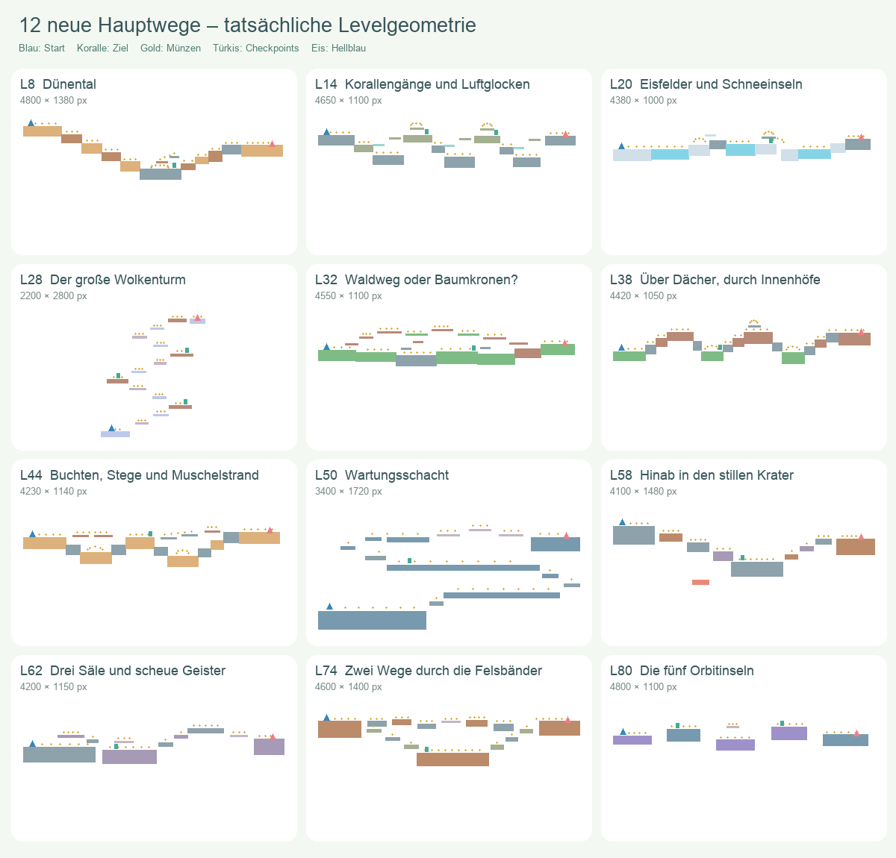

# Levelvielfalt: Vergleich und Umbauplan

Stand: 20. November 2026. Analyse der aktuellen 90 Level aus `ALL_LEVELS`, der vorhandenen Engine und veröffentlichter Entwicklerberichte. Keine Behauptung, die Vergleichsspiele hier selbst durchgespielt zu haben. Die zwölf unten beschriebenen Hauptweg-Rewrites sind umgesetzt. Die Messwerte im Befundabschnitt dokumentieren den Zustand vor diesem Umbau.

## Befund im eigenen Spiel

Die Ähnlichkeit betrifft vor allem die Handlungsfolge: nach rechts laufen, kleine Lücken und Höhenstufen überwinden, einzelne Patrouillen, Münzbogen, Flagge. Andere Farben und zusätzliche Bonusobjekte verändern diese Folge nur wenig.

- `naturePolish.ts` erhält ausdrücklich die Sprungoberkanten und ergänzt Fundamente, Belohnungen und Erholungsstellen. Seine 42 Ideen sind überwiegend eine Überarbeitung bestehender Routen.
- `classicExpansion.ts` ergänzt 24 Level ohne Änderung der Pflichtgeometrie. Flügelgegner, Ringe und Lianen sind lokale Ergänzungen.
- Die sechs wiederkehrenden Weltslots sind weiterhin erkennbar: Einstieg, Lücken, Röhren, Aufstieg, Horde, Finale. Bereits Phase 9 hat dieses Problem beschrieben; die späteren Politurphasen haben es nicht grundlegend beseitigt.
- Vielfaltstests prüfen z. B. Plattformbreiten, Höhenschichten, Elementvorkommen und Erreichbarkeit. Sie beweisen weder unterschiedliche Hauptwege noch interessante Entscheidungen.

### Messung der aktuellen Daten

Reproduzierbares Audit: `scripts/audit-level-variety.ts` (Aufruf im Dateikopf); Snapshots: [vorher](level-variety-metrics-before.json) und [nachher](level-variety-metrics.json).

Die Elementzahlen zählen Level mit mindestens einem entsprechenden Element, nicht Objekte. Sie beschreiben Präsenz, nicht tatsächliche Nutzung auf dem Pflichtweg.

| Merkmal | Befund |
|---|---|
| Bewegliche Plattformen | 90/90 Level |
| Federn | 87/90 Level |
| Stacheln | 81/90 Level |
| Lianen / Feuerarme / Rotmünzen | 4 / 4 / 6 Level |
| Zusätzliche Ziele / Röhren-Warps | 3 / 1 Level |
| Breite | 5600–18200 px; Median 11200 px |
| Lange Strecken | 39 Level mindestens 12000 px breit |
| Wiederkehrender Einstieg | In 13/15 Welten ist Level 1 mindestens geteilt das kürzeste |
| Wiederkehrendes Finale | In 13/15 Welten liegt Level 6 unter den zwei längsten |
| Wiederkehrende Horde | In 12/15 Welten hat Level 5 mindestens geteilt die meisten Gegner |

Auch die Bodengeometrie zeigt Wiederholung: Im Wald entfallen in L31 etwa 82%, in L32 etwa 80% der aufsummierten festen Plattformbreiten auf jeweils eine einzige Oberkantenhöhe. Diese Flachheitsmetrik zählt parallele/überlappende Flächen mehrfach; sie rekonstruiert keinen tatsächlich gespielten Weg.

Breite allein ist keine Spielzeit. 11200 px entsprechen bei 300 px/s rund 37 Sekunden reiner Horizontalbewegung ohne Sprünge, Umwege oder Wartezeit. Die Zahlen erklären mögliche Streckung, belegen aber keine Langeweile. Eine Mindestmenge verschiedener Elemente ist ebenfalls kein Qualitätsmaß: Federn und Mover in fast jedem Level verlieren ihre prägende Wirkung.

## Was die Vergleichsspiele leisten

Die beobachteten Eigenschaften sind durch die Quellen gestützt; die Übertragung auf unser Spiel ist eine eigene Designableitung.

| Spiel | Belegter Ansatz | Ableitung für unser Spiel |
|---|---|---|
| Super Mario Bros. Wonder | Wonder-Effekte verwandeln Landschaft und Gameplay; Nintendo beschreibt auch gemeinsam mit dem Soundteam entworfene rhythmische Kurse [1,2]. | Ein Level braucht eine erinnerbare Veränderung seiner Aufgabe. Eine schöne Kulisse allein genügt nicht. Neue Geometrie kann diese Abwechslung zunächst ohne eine große Verwandlungsengine liefern. |
| Donkey Kong Country: Tropical Freeze | Die Anleitung unterscheidet Loren mit Sprung/Ducken, steuerbare Raketenfässer und Rambi-Passagen [3]. | Unterschiedliche Arten der Fortbewegung verändern die Aufgaben. Zunächst können wir Bodenlauf, Tauchgang, Aufstieg und Abstieg aus vorhandener Technik deutlich unterscheiden. Fahrzeuge wären eine spätere Engine-Erweiterung. |
| Rayman Legends | Ubisoft beschreibt Musiklevel, deren Leveldesign aus der Musik entwickelt wurde, sowie rhythmisch abgestimmte Spielobjekte und Sounds [4]. | Ein geplanter Rhythmusparcours braucht eine gemeinsame Game-Time-Musikphase. Das bloße Ändern der Hintergrundmusik oder gleichmäßiger Plattformabstände ist kein synchrones Musiklevel. |
| Astro Bot | Team Asobi beginnt mit Gameplayideen und Prototypen; Weltgestaltung folgt der spielerischen Idee. Fähigkeiten unterstützen unterschiedliche Spielweisen [5,6]. | Erst einen Abschnitt ohne Dekoration auf seinen Spielwert prüfen. Danach Landschaft und Grafik um diese Idee bauen. |
| Super Mario 3D World | Nintendo trennt das Erreichen des Ziels von zusätzlichen Sammelherausforderungen für Fortgeschrittene [7]. | Verständlicher Hauptweg und anspruchsvolle Belohnungen ergänzen sich. Der Hauptweg muss trotzdem pro Level ein anderes Profil haben. |

## Neue verbindliche Designrichtung

Diese Regeln ersetzen die globale Sechs-Slot-Schablone als Ziel für zukünftige Rewrites; bestehende Level bleiben bis zu ihrem Umbau gültig.

1. **Ein prägender Satz pro Level.** Er beschreibt eine Handlung: „Im Zickzack durch den Schacht aufsteigen“, nicht nur „Wald mit Münzen“.
2. **Die Hauptstrecke trägt die Idee.** Einzigartigkeit darf nicht ausschließlich in einer Bonusnische liegen. Alternative Wege sind bewusste Entscheidungen mit anderem Zeitbedarf oder Risiko.
3. **Räumliche Formen wechseln.** Kompakter Turm, langer Abstieg, offene Gabelung, niedriger Tunnel und rhythmische Inselkette dürfen sich auch innerhalb eines Bioms abwechseln. Keine neue identische Reihenfolge für alle 15 Welten.
4. **Gezielte Auswahl statt Vollausstattung.** Keine neue Pflicht, jedem Level Mover/Federn/Stacheln zu geben. Vorhandene globale Vorkommens-Tests und die Dokumentation müssen beim jeweiligen Rewrite angepasst werden; harte Pilot-Pins bleiben bestehen.
5. **Kurze Ideen dürfen kurz sein.** Unterschiedliche Abschnittszahl und Länge statt gleicher Strecken mit zusätzlichen Wiederholungen. Geplante Laufzeiten werden später im Playtest gemessen, nicht aus Breite behauptet.
6. **Eine Idee entwickeln.** Sicher zeigen, eine Variante anbieten, mit einer bekannten Gefahr kombinieren, mit einem eigenen Höhepunkt abschließen. Abschnittslängen und Anzahl bleiben variabel.
7. **Fairness bleibt.** Direkte Steuerung, kein Sprintzwang, sichtbare Landeplätze, biomeabhängige Sprunggrenzen und sinnvoll gesetzte Checkpoints. Kein Auto-Fixer als Ersatz für Entwurf.

### Wichtige technische Grenze

Der bisherige Solver kennt weder Lianen noch Federn, Wasser-/Windzonen und Schlüsselabläufe vollständig. Sie bleiben gemäß bestehender Spezifikation optional. Hauptwege dürfen räumlich neu gestaltet werden, müssen aber weiter ohne diese Sonderaktionen physikalisch lösbar sein. Pflicht-Lianen, reine Schwimmrätsel, Fahrzeuge oder zwingende Musik-/Schalterabläufe brauchen zuerst eine explizite Spec- und Solver-Erweiterung mit Runtime-Tests. Ein sicherer alternativer Weg darf die zentrale Idee nicht zu einer unsichtbaren Nebensache machen.

## Umgesetzte gezielte Rewrites

Die Auswahl mischt Formen über die Kampagne; sie ist keine neue pro Biom wiederholte Sechserfolge. Die Geometrie liegt in `src/data/levels/variety/`; jedes Level wird vollständig ersetzt, die übrigen 78 bleiben unverändert.

| Level | Prägende Aufgabe | Hauptweg und Rhythmus | Technik |
|---|---|---|---|
| L8 Wüstenkluft | Tief in eine Schlucht hinab und seitlich wieder heraus | Abstieg, breite Talsohle, kurzer Gegenanstieg; deutlich andere Silhouette als eine flache Lückenkette | Statische Geometrie, Wind nur mit sicherer Alternative |
| L14 Korallengänge | Zwischen offenem Wasser und engen trockenen Galerien wechseln | Große Höhlen verbinden kurze Gänge; obere Trittfolge erhält den solverprüfbaren Weg | Vorhandene Wasserzonen; Clearance prüfen |
| L20 Gletscher | Kurze Eisstrecken präzise verlassen | Griffige Schneeinseln setzen Brems-/Sprungentscheidungen; kein globales Rutschen | Vorhandenes Eis, reguläre Sprünge |
| L28 Wolkenturm | Einen kompakten Schacht im Zickzack erklimmen | Deutlich geringere Breite, mehr echte Höhe, versetzte sichere Zwischenbalkone | Kamera unterstützt Höhe; Mover bleibt optional |
| L32 Baumkronen | Zwischen tiefem Waldweg und hohem Kronenweg wählen | Zwei länger zusammenhängende Routen, die an Lichtungen zusammenfinden | Statische Plattformen; Lianen nur Abkürzung |
| L38 Dächer | Über Dächer steigen und in Innenhöfe springen | Anstieg, großer lesbarer Absprung, Hofpause; wenige gezielte Wächter | Neue Dach-/Hofgeometrie, keine neuen Fähigkeiten |
| L44 Gezeitenstrand | In Buchten absteigen und auf Stegen weiterkommen | Untere sichere Bögen und obere kurze Sprungpassagen mit sichtbarer Wiedervereinigung | Statische Küstenform; Wasser unterstützt |
| L50 Maschinenkreuzung | Sich durch querliegende Maschinenetagen bewegen | Kurze Richtungswechsel und vertikale Verbindungen statt langer Stahlträgerlinie | Statische sichere Route; Förderband-/Mover-Abzweige |
| L58 Krater | Auf der Innenseite eines Kraters hinabsteigen | Abstieg, ruhige Mitte, kurzer Ausstieg; Gefahren an angekündigten Kanten | Statische Stufen, kleinere Sprungreserve bei g=2200 |
| L62 Spiegelgalerie | Beobachten, umdrehen und weitergehen | Kurze Boo-Begegnungen in verbundenen Räumen, dazwischen ruhige Übergänge | Bestehende Blickkontakt-KI; keine Türpflicht |
| L74 Canyon | Mehrere versetzte Felsbänder überqueren | Breite Auffangbänder unten und kurze exponierte Verbindungen oben | Statische Geometrie; Bröckeln nur auf Bonusweg |
| L80 Planetenbogen | In großen Bögen durch eine offene Raumfolge springen | Wenige weit auseinanderliegende große Körper statt vieler gleich kleiner Tritte | g=1000, keine Federpflicht, sichtbare Landungen |

L1/L2 behalten ihre Einführungen, L11 seinen Gegner-Pin, L37 den tragenden Brick, L90 seine Bossarena. Bei L3 bleiben Brick und Runtime-Anker bestehen. Keine Änderung an der Weltreihenfolge, Musik oder direkten Steuerung. Die zwölf Rewrites verwenden eine Kamera, die auch nach links folgt.

## Abnahme und weitere Arbeit

- Alle zwölf Rewrites sind integriert; L8, L28, L50 und L62 bilden die stärksten räumlichen Kontraste. Keine globale Politurfunktion legt nur ähnliche Objekte auf bestehende Wege.
- Vorher/Nachher vergleichen: Hauptweg-Silhouette, Richtungswechsel, bedeutungsvolle Verzweigungen, Abschnittslänge, tatsächliche Spieleraktionen. Gleiche Sprungfolge trotz anderer Kulisse bedeutet noch keinen Erfolg.
- Ballistischer Solver für alle Ziele und Bonusplattformen; Auto-Fixer ergänzt nichts. Bestehende Pins, Clearance, Spawn-/Goal-Sicherheit und Elementregeln bleiben geprüft.
- Pro verändertem Biom BiomeAudit, dazu globale Level-/Element-/Physiktests. Neue aktive Pflichtmechaniken benötigen zuerst passende Solver- und E2E-Prüfungen.
- Anschließend echte Playtests für Lesbarkeit, Wartezeiten und Wiederholungen. Datenmetriken sind Hinweise, kein automatisches Gütesiegel für Spaß.

## Quellen

1. [Nintendo: Wonder, Kapitel 1 — Transformation](https://www.nintendo.com/en-gb/News/2023/October/Ask-the-Developer-Vol-11-Super-Mario-Bros-Wonder-Chapter-1-2460393.html)
2. [Nintendo: Wonder, Teil 3 — Musik und Leveldesign](https://www.nintendo.com/us/whatsnew/ask-the-developer-vol-11-super-mario-bros-wonder-part-3/)
3. [Nintendo: Tropical Freeze, offizielle Anleitung, Abschnitt 15](https://csassets.nintendo.com/noaext/image/private/t_KA_PDF/manual-WiiU-Donkey_Kong_Country_Tropical_Freeze?_a=DATAg1AAZAA0)
4. [Ubisoft: Music & Audio Design](https://www.ubisoft.com/en-us/news/ignt.64602/music-audio-design)
5. [PlayStation: Astro Bot — Entwicklerinterview](https://blog.playstation.com/2024/09/09/astro-bot-how-team-asobi-created-a-unified-vision-for-fun/)
6. [Sony: Astro Bot — unterschiedliche Fähigkeiten](https://sonyinteractive.com/en/press-releases/2024/embark-on-a-galactic-quest-with-astro-bot-launching-today-on-playstation-5/)
7. [Nintendo: Super Mario 3D World — Hauptziel und zusätzliche Herausforderungen](https://www.nintendo.com/de-de/Iwata-fragt/Iwata-fragt-SUPER-MARIO-3D-WORLD/SUPER-MARIO-3D-WORLD/3-Ganz-instinktiv-ein-gutes-Gefuhl-/3-Ganz-instinktiv-ein-gutes-Gefuhl--829583.html)

## Umsetzungsergebnis

| Level | Neue Größe | Prägender Unterschied |
|---|---|---|
| L8 | 4800 × 1380 | 780 px Abstieg ins Dünental, kurzer Oasenausstieg |
| L14 | 4650 × 1100 | Drei Becken mit erhöhten Luftgalerien |
| L20 | 4380 × 1000 | Lange Eisfelder und griffige Schneelandungen |
| L28 | 2200 × 2800 | 2340 px Aufstieg, vier Richtungswechsel, drei Checkpoints |
| L32 | 4550 × 1100 | Über 2400 px getrennte Wald-/Baumkronenwege |
| L38 | 4420 × 1050 | Verbindliche Dachaufstiege und zwei Innenhöfe |
| L44 | 4230 × 1140 | Zwei Buchten, unterschiedliche obere Steg-/Felswege |
| L50 | 3400 × 1720 | Maschinenetagen mit Hin-, Rück- und erneutem Hinweg |
| L58 | 4100 × 1480 | Kraterabstieg, ruhige Talsohle und kurzer Ausstieg |
| L62 | 4200 × 1150 | Galerie, Treppenhalle, Dachkammer und Boo-Begegnungen |
| L74 | 4600 × 1400 | Exponiertes Felsband und tiefer langer Auffangweg |
| L80 | 4800 × 1100 | Fünf große Orbitinseln, 300–320 px Luftquerungen |

Die Kampagne hat weiterhin 90 Level. Bewusste statische Rewrites senken Mover-Vorkommen von 90 auf 78 Level, Federn von 87 auf 76 und Stacheln von 81 auf 69. Die Gesamtbreite sinkt von 1.017.800 auf 946.030 px (71.770 px weniger). Das ist eine Längenmessung, keine behauptete Spielzeitverkürzung. Alle Änderungen bleiben deterministisch und überschreiben veraltete Objektkoordinaten vollständig.

Neue Unit-Tests prüfen unterschiedliche Hauptwegformen, Solver-Erreichbarkeit ohne Mover, Idempotenz, feste Pins, Spawn-/Checkpoint-Sicherheit und beispielhaft durchgehende kollisionsfreie Sprungkurven für kleine/große Körper. Die zusätzliche Kurvenabtastung erkennt Seiten-/Deckenkollisionen, die der reine Ballistiksolver nicht modelliert. Sie ist ebenfalls kein vollständiger Runtime-Beweis. Die 15 neuen E2E-Fälle decken Spawns, Turmsprung, Rückwärtskamera und Zielabschluss ab. Ihre Ausführung ist hier durch `listen EPERM` beim lokalen Serverstart blockiert; echte Playtests bleiben offen.
